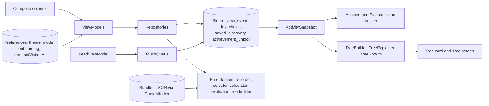

# Architecture Documentation

## 1. Purpose and Scope
Curio is an offline-first Android application turning vertical swipes into a finite, structured daily feed of educational discoveries across themes and topics. Developer A's core architectural domain encompasses view tracking and event recording, day plan generation, bonus discovery selection, user activity snapshots, achievement evaluation, knowledge tree growth modeling, progress calculation, fresh-first feed reordering, past-day read-only views, and Detail screen reading time tracking.

## 2. Layers
- **UI Presentation**: Jetpack Compose screens (`FeedScreen`, `DetailScreen`, `AchievementsScreen`, `LibraryScreen`, `ProgressScreen`, `SettingsScreen`, `SourcesScreen`, `TreeScreen`) driven by ViewModels (`FeedViewModel`, `DetailViewModel`, `ProgressViewModel`, `AchievementsViewModel`, `SettingsViewModel`, `TreeScreenViewModel`, `TreeViewModel`).
- **Repositories & Data Sources**: Room DAOs and repositories (`DayPlanRepository`, `ProgressRepository`, `BonusRepository`, `UserActivityRepository`, `AchievementRepository`, `FreshnessRepository`), DataStore settings (`PreferencesSettingsStore`, `PreferencesTreeVisitStore`), and bundled JSON assets via `ContentIndex`.
- **Pure Domain**: Stateless logic (`DetailReadingTracker`, `TopicSelector`, `FeedComposer`, `FeedAssembler`, `FeedDateResolver`, `FreshFirst`, `ProgressCalculator`, `ShakeBonusSelector`, `TreeBuilder`, `TreeExplainer`, `TreeGrowth`, `AchievementEvaluator`, `ViewEventRecorder`).

## 3. Data Flow Diagram

## 4. Persisted Data
- **Room Entities (`version = 1`, `exportSchema = true`)**:
  - `view_event`: `discoveryId`, `date`, `firstViewedAt`, `dwellMs`, `completed`, `skipped`, `source`, `detailDwellMs` (PrimaryKey: `discoveryId`, `date`).
  - `day_choice`: `date`, `themeId`, `topicId`, `mode` (PrimaryKey: `date`).
  - `saved_discovery`: `discoveryId`, `savedAt` (PrimaryKey: `discoveryId`).
  - `achievement_unlock`: `achievementId`, `unlockedAt`, `notifiedAt`, `seenAt` (PrimaryKey: `achievementId`).
- **Preferences DataStore**: Settings store (theme, daily mode, haptics, shake) and tree visits store.

## 5. Rules of the Product
- **Completion**: A discovery is completed after 3 seconds on screen in the feed, or when opened in Detail, or when saved.
- **Day Completion**: A day is complete only with the 6 discoveries of its topic finished in the feed (`source = FEED`).
- **Source Priority**: `FEED` > `BONUS` > `DETAIL`; dwell times add up.
- **Past Days**: Past days with stored choices open read-only; progress cannot be modified.
- **Badges**: Unlocked once based on distinct discoveries in `ActivitySnapshot`.
- **Knowledge Tree**: Built dynamically from `ActivitySnapshot` and rendered in UI.
- **Surprise Avoidance**: In Surprise mode, `TopicSelector.surprise` and `DayPlanRepository.ensureToday` avoid yesterday's stored topic to prevent consecutive duplicate topics.

## 6. Product Constants
- `DAILY_FEED_SIZE`: 6
- `COMPLETE_AT_MS`: 3,000L
- `SKIP_BELOW_MS`: 1,500L
- `EXPLORED_AT`: 3
- `MAX_BONUS_PER_DAY`: 3
- `CHECKPOINT_MS`: 3,000L
- `MAX_DELTA_MS`: 120,000L
- `TopicConfig.SURPRISE_AVOIDS_YESTERDAY`: true

## 7. Time and Randomness
`java.time.Clock` is injected into repositories and ViewModels. Pure domain logic never accesses system time or unseeded random sources.

## 8. Testing Strategy
Tested via JUnit unit tests (domain and ViewModels) and instrumented Room / integration tests (`AndroidTest`).

## 9. Extension Points
Adding new badges or themes follows modular domain extension rules without altering core architecture.

## 10. Known Limitations
Refer to `docs/OPEN_DECISIONS.md`.
