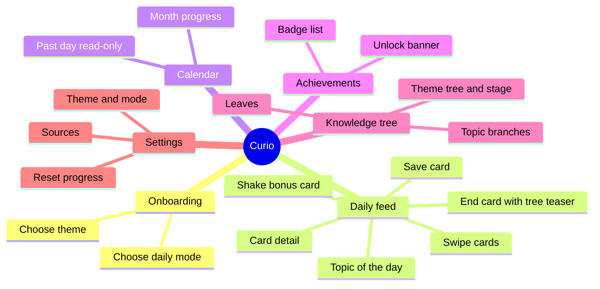
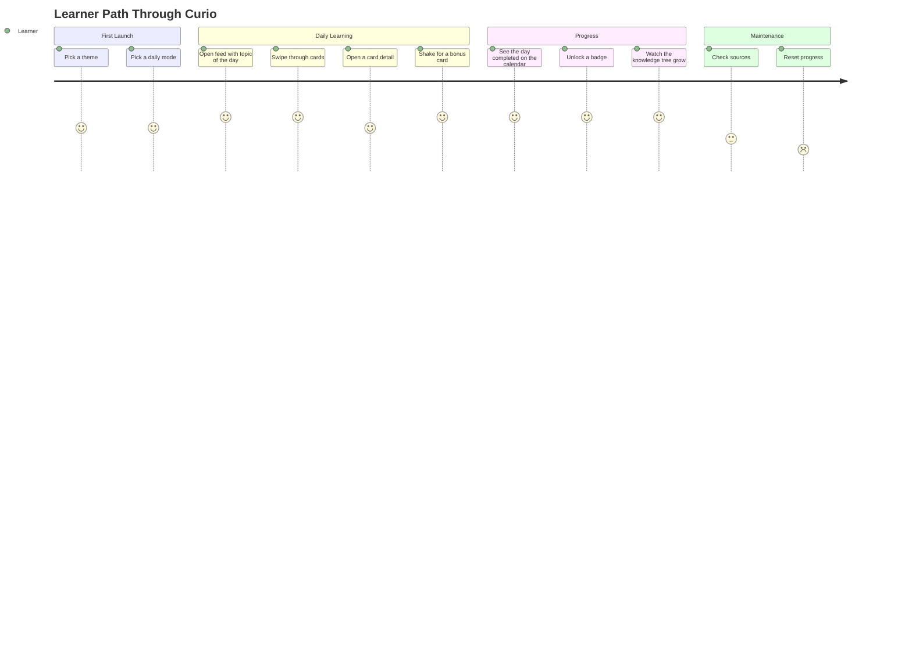
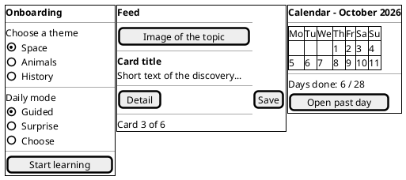
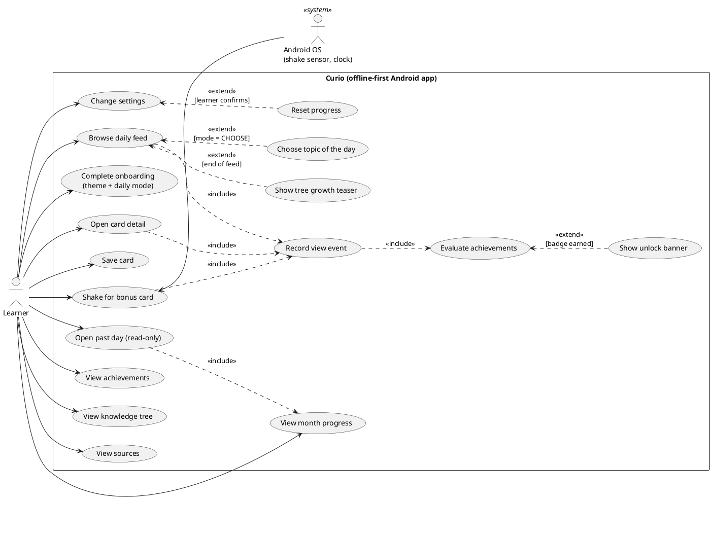
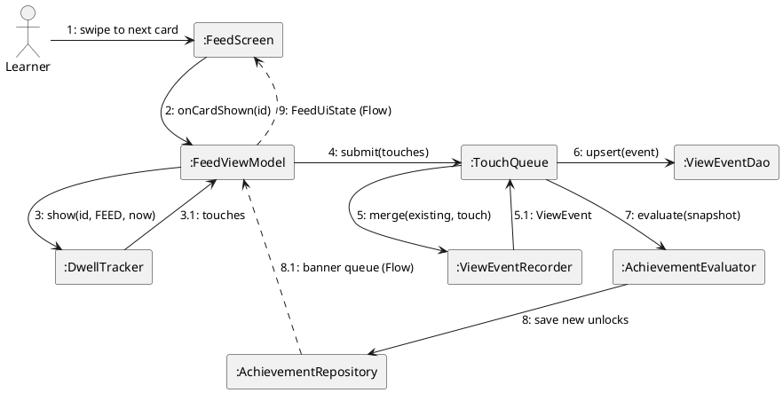
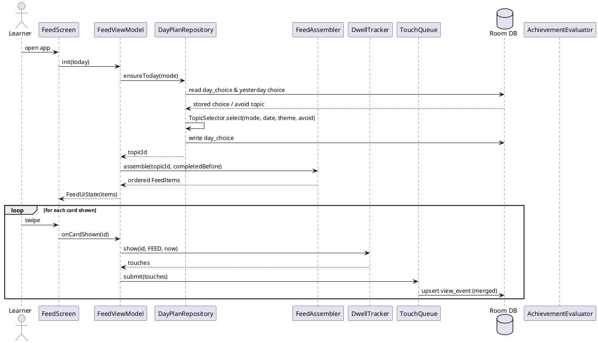
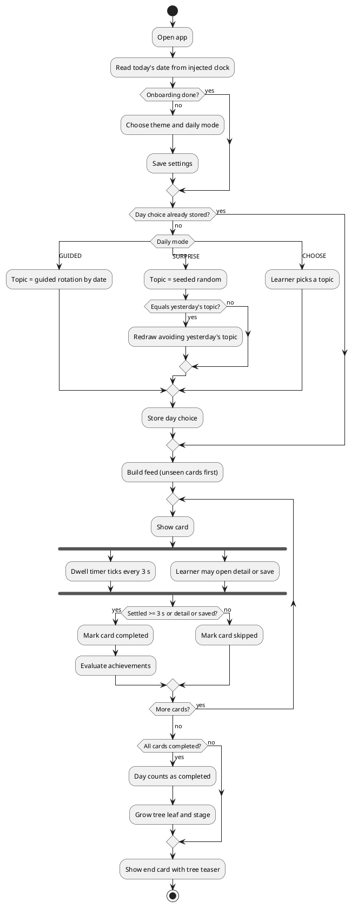
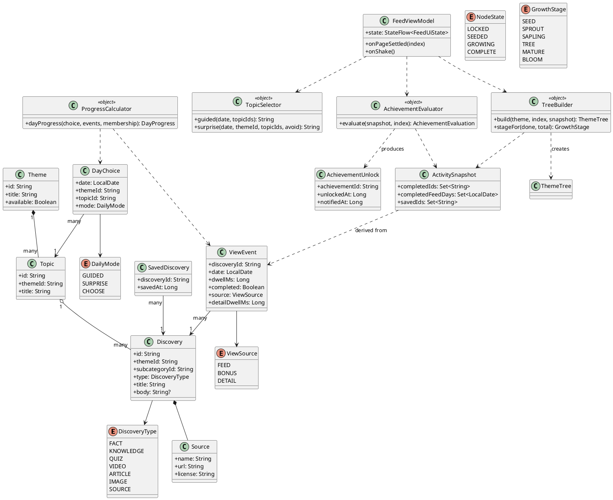
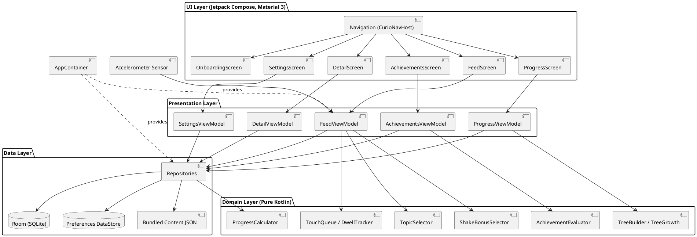

# Curio: Requirements and Architecture Diagrams

This document outlines the complete project specifications, feature set, user paths, wireframes, tech stack, and structural/behavioral/functional diagrams for **Curio**, an offline-first educational Android application.

---

# 1. Project Specifications

## 1.1 Project Description
Curio is an offline-first Android application that delivers a daily curated educational feed in a modern vertical pager format (one discovery card at a time). Users select a theme (e.g., Space, Animals) and a daily delivery mode (Guided, Surprise, or Choose). Each day, the app presents a structured sequence of discoveries for that day's topic. A discovery card is marked complete after 3 seconds on screen, when opened in Detail, or when bookmarked. A day is completed when all 6 discoveries of its topic are completed in the feed.

Curio rewards consistent learning through a month progress calendar, unlockable badges (Achievements), and an interactive Knowledge Tree that grows through six stages (Seed, Sprout, Sapling, Tree, Mature, Bloom) based on accumulated discoveries. Shaking the device provides bonus discovery cards (capped at 3 per day). All content is bundled locally, ensuring full offline capability from first launch.

**Success Criteria:**
- First-launch onboarding completes and renders the initial feed card in under 1 minute.
- Full functionality operates seamlessly in airplane mode without internet permissions.
- Card completion, day completion, and achievement evaluation are 100% deterministic and unit-tested.
- Vertical feed scrolling maintains a stable frame rate without jank on mid-range devices.

**Timeline & Budget:** Milestone 1 (M1) completed; Milestone 2 (M2) targeted for mid-December; final submission January 2027. Student project with zero monetary budget and two engineering developers.

## 1.2 Features (Screens and Capabilities)
1. **Onboarding**: Theme selector and daily mode picker (Guided, Surprise, Choose).
2. **Feed (Home)**: Vertical discovery pager, detail view, bookmarking, shake bonus cards, end card with tree growth teaser, and achievement unlock banners.
3. **Card Detail**: Full article text, "Pe scurt" knowledge summary, publisher source, and licence attribution.
4. **Calendar (Progress)**: Month grid tracking completed days, with tap-to-open read-only past-day feeds (`FeedDay`).
5. **Achievements**: Grid of unlocked and locked badges with detailed progress and unlock timestamps.
6. **Knowledge Tree**: Theme tree progress, topic branch states (Locked, Seeded, Growing, Complete), and landmark discovery exploration.
7. **Settings**: Theme and daily mode switching, sources and licences review, and progress reset.



## 1.3 User Path and User Stories
Only one primary user role exists (**Learner**), alongside the Android system as a secondary actor (clock, accelerometer sensor).



**User Stories:**
- **US1**: As a learner, I can pick a theme and daily mode at first launch so that the feed matches my interests.
- **US2**: As a learner, I can swipe through today's cards so that I learn one small thing at a time.
- **US3**: As a learner, I can open a card's detail so that I can read more.
- **US4**: As a learner, I can save a card so that I can find it again.
- **US5**: As a learner, I can shake my phone to get a bonus card so that I can keep learning after today's topic.
- **US6**: As a learner, I can see my month on a calendar so that I know which days I completed.
- **US7**: As a learner, I can reopen a past day in read-only mode so that I can review it.
- **US8**: As a learner, I can unlock badges so that I feel rewarded for regular learning.
- **US9**: As a learner, I can see a knowledge tree so that I see how much I have learned in a theme.
- **US10**: As a learner, I can see the sources and licences of the content so that I trust it.
- **US11**: As a learner, I can reset my progress so that I can start again.
- **US12**: As a learner, I can use the whole app offline so that I can learn anywhere.

**Requirements Summary:**
- **Functional**: FR1 (Daily topic selection by mode with Surprise yesterday avoidance); FR2 (Card completion after 3s, Detail opened, or saved); FR3 (Day completion by topic feed cards); FR4 (Achievement evaluation from snapshot); FR5 (Knowledge tree branch states and growth stages); FR6 (Shake bonus cards capped at 3 per day).
- **Non-Functional**: NFR1 (Offline-first local bundled content); NFR2 (Deterministic topic selection); NFR3 (Pure Kotlin domain logic testable without Android); NFR4 (Exported Room database schema).

## 1.4 Mock-ups / Wireframes (PlantUML Salt)



## 1.5 Tech Stack
- **Language**: Kotlin 2.0+
- **UI Framework**: Jetpack Compose, Material 3 (Lagoon design system)
- **Navigation**: Navigation Compose (typed routes with kotlinx.serialization)
- **Local Database**: Room (SQLite) with exported schema (`version = 1`)
- **Settings Store**: DataStore Preferences
- **Concurrency**: Kotlin Coroutines & Flows
- **Dependency Injection**: Manual `AppContainer`
- **Time & Platform**: `java.time.Clock` (injected), Android Sensor API (Accelerometer for shake detection)
- **Testing**: JUnit 4, Kotlin Coroutines Test, AndroidX Test (Room migration / instrumented tests)

---

# 2. Project Requirements: Diagrams

## 2.1 Behavioral Diagrams

### 2.1.1 Use-Case Diagram (PlantUML)


### 2.1.2 Collaboration Diagram (PlantUML)


### 2.1.3 Sequence Diagrams (PlantUML)
**Browsing the Feed:**


### 2.1.4 Activity Diagram (PlantUML)


## 2.2 Structural Diagrams

### 2.2.1 Class Diagram (PlantUML)


### 2.2.2 Component Diagram (PlantUML)


---

# 3. Pseudocode of Main Rules

**Card Completion (F0):**
```kotlin
fun isCardCompleted(event: ViewEvent): Boolean =
    event.completed || event.dwellMs >= 3000L || event.detailDwellMs > 0L
```

**Day Completion (F1):**
```kotlin
fun dayProgress(choice: DayChoice, events: Collection<ViewEvent>, membership: TopicMembership): DayProgress {
    val topicItems = membership.discoveriesOf(choice.topicId)
    val done = events.asSequence()
        .filter { it.date == choice.date }
        .filter { it.completed && it.source != ViewSource.BONUS }
        .filter { it.discoveryId in topicItems }
        .map { it.discoveryId }
        .toSet().size
    return DayProgress(choice.date, choice.topicId, done, topicItems.size)
}
```

**Surprise Mode Avoidance (Step 19 / P8):**
```kotlin
fun surprise(date: LocalDate, themeId: String, topicIds: List<String>, avoidTopicId: String? = null): String? {
    if (topicIds.isEmpty()) return null
    val seed = mix(date.toEpochDay() * 31L + themeId.hashCode())
    val first = topicIds[Random(seed).nextInt(topicIds.size)]
    if (avoidTopicId == null || first != avoidTopicId || topicIds.size == 1) return first
    val others = topicIds.filter { it != avoidTopicId }
    return others[Random(mix(seed xor REDRAW_SALT)).nextInt(others.size)]
}
```

---

# 4. Handover Checklist
- [x] Project specifications and user journey defined.
- [x] PlantUML and Mermaid architectural diagrams updated.
- [x] Core domain rules and pseudocode documented.
- [x] All 495 unit tests passing successfully.
